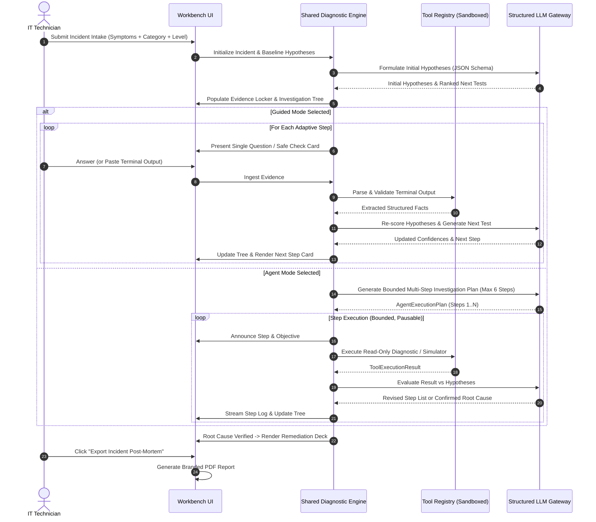

# FixFlow AI — Architecture Specification

**Version:** 1.0.0  
**Status:** Approved for Implementation  
**Target:** Hackathon MVP & Production-Ready Diagnostic Workbench  
**Author:** Lead Product Engineer  

---

## 1. System Overview & High-Level Architecture

FixFlow AI is architected as an offline-capable, client-first Next.js App Router application with a modular server-side diagnostic API. The application operates in two interchangeable runtime environments:
1. **Live LLM Connected Mode:** Calls server-side route handlers with strict JSON Schema structured output when an LLM provider key (e.g. Gemini / OpenAI / Anthropic) is configured.
2. **Deterministic / Offline Mode:** Uses an embedded deterministic rule and knowledge engine that executes the full diagnostic lifecycle offline without external dependencies.

```mermaid
flowchart TB
    subgraph Client["Browser Client (React 19 / Next.js Client Layer)"]
        UI["Workbench UI (Tri-Pane Layout)"]
        
        subgraph StateManagement["Client State & Storage"]
            SM["Diagnostic State Machine (Zustand/React Context)"]
            IDB[("IndexedDB (Dexie.js) - Incidents & Evidence")]
            ExportEngine["PDF & JSON Export Engine"]
        end
        
        subgraph Visuals["Interactive Visualizers"]
            ITree["Investigation Tree (SVG/Canvas Graph)"]
            HypMatrix["Hypothesis Matrix & Confidence Bars"]
            EvLocker["Evidence Locker & Telemetry Viewer"]
        end
        
        UI <--> SM
        SM <--> IDB
        SM --> ITree
        SM --> HypMatrix
        SM --> EvLocker
        SM --> ExportEngine
    end

    subgraph Server["Next.js Server Layer (App Router)"]
        subgraph Routes["API Route Handlers (/api/diagnose)"]
            RouteGuided["POST /api/diagnose/guided"]
            RouteAgent["POST /api/diagnose/agent"]
            RouteTools["POST /api/tools/execute"]
        end

        subgraph CoreEngine["Shared Diagnostic Engine"]
            Engine["Diagnostic Core Engine"]
            ToolReg["Tool Registry (Read-Only / Safe Parsers)"]
            SafePolicy["Safety Enforcement & Redaction Filter"]
        end

        subgraph LLMIntegration["LLM Structured Output Gateway"]
            LLMClient["Gemini / OpenAI Structured Output Client"]
            ZodSchemas["Zod Output Schema Validators"]
            DetEngine["Deterministic Fallback & Replay Engine"]
        end

        Routes --> Engine
        Engine --> ToolReg
        Engine --> SafePolicy
        Engine --> LLMClient
        Engine --> DetEngine
        LLMClient --> ZodSchemas
    end

    SM <--> Routes
```



---

## 2. Technology Stack

| Layer | Technology | Selection Justification |
|---|---|---|
| **Framework** | Next.js 15+ (App Router) | Industry standard for modern web applications, combining fast static client rendering with secure server-side API routes for API key isolation. |
| **Language** | TypeScript 5+ (Strict Mode) | Full type-safety across shared domain models (Incident, Evidence, Hypothesis, Tool Calls). |
| **UI & Styling** | React 19, Tailwind CSS v4, Lucide React, Radix UI Primitives | Clean, responsive IT workbench design without bulky UI frameworks. High accessibility, dark mode native. |
| **Data Validation** | Zod 3.x | End-to-end schema validation for user input, tool execution payloads, and LLM structured JSON output. |
| **Local Persistence** | Dexie.js (IndexedDB wrapper) | Blazing-fast client-side persistence for incidents, evidence logs, and custom telemetry; eliminates server database overhead for solo hackathon scope. |
| **PDF Generation** | HTML5 Print CSS & `@react-pdf/renderer` / Browser Print Bridge | Generates clean, pixel-perfect, branded IT post-mortem reports with zero external cloud dependencies. |
| **LLM Gateway** | Server-side Gemini API (`@google/genai`) / Provider Agnostic Adapter | Native support for structured JSON schemas (`responseSchema`), zero prompt injection leakage into the client, and deterministic fallback. |

---

## 3. Core Domain Models (TypeScript & Zod Schemas)

All models are defined in `@/types/incident.ts` and validated with matching Zod schemas in `@/lib/schemas/incident.ts`.

### 3.1 Incident Model
```typescript
export type ExperienceLevel = 'beginner' | 'intermediate' | 'advanced';

export type IncidentCategory =
  | 'networking'
  | 'dns'
  | 'vpn'
  | 'firewall'
  | 'windows'
  | 'accounts_permissions'
  | 'applications_services'
  | 'servers_virtualization'
  | 'email'
  | 'backup_storage'
  | 'printers_peripherals'
  | 'endpoint_security';

export type IncidentSeverity = 'P1_critical' | 'P2_high' | 'P3_medium' | 'P4_low';
export type BlastRadius = 'single_user' | 'team_department' | 'branch_site' | 'enterprise_wide';
export type DiagnosticMode = 'guided' | 'agent';

export interface Incident {
  id: string;
  title: string;
  description: string;
  rawSymptoms: string;
  category: IncidentCategory;
  experienceLevel: ExperienceLevel;
  severity: IncidentSeverity;
  blastRadius: BlastRadius;
  mode: DiagnosticMode;
  status: 'triage' | 'investigating' | 'root_cause_identified' | 'resolved' | 'closed';
  createdAt: number;
  updatedAt: number;
  hypotheses: Hypothesis[];
  evidence: EvidenceItem[];
  investigationNodes: InvestigationNode[];
  guidedSteps: GuidedStep[];
  agentExecutionPlan?: AgentExecutionPlan;
  finalReport?: IncidentReport;
}
```

### 3.2 Evidence & Hypothesis Model
```typescript
export type HypothesisStatus = 'tentative' | 'likely' | 'confirmed' | 'refuted';

export interface Hypothesis {
  id: string;
  title: string;
  description: string;
  category: IncidentCategory;
  confidence: number; // 0.00 to 1.00
  status: HypothesisStatus;
  supportingEvidenceIds: string[];
  refutingEvidenceIds: string[];
  recommendedTestIds: string[];
  rootCauseProbability: number;
}

export type EvidenceSource = 'user_input' | 'cli_output' | 'system_log' | 'tool_execution' | 'manual_observation';
export type EvidenceImpact = 'supports' | 'refutes' | 'neutral' | 'inconclusive';

export interface EvidenceItem {
  id: string;
  timestamp: number;
  source: EvidenceSource;
  title: string;
  rawOutput: string;
  summary: string;
  relatedHypothesisId?: string;
  impact: EvidenceImpact;
  verified: boolean;
  metadata?: Record<string, string | number | boolean>;
}
```

### 3.3 Investigation Tree Model
```typescript
export type NodeType = 'symptom' | 'hypothesis' | 'diagnostic_check' | 'evidence' | 'root_cause' | 'remediation';
export type NodeStatus = 'active' | 'passed' | 'failed' | 'pending' | 'pruned';

export interface InvestigationNode {
  id: string;
  parentId?: string;
  type: NodeType;
  label: string;
  description: string;
  status: NodeStatus;
  confidence?: number;
  evidenceRefId?: string;
  hypothesisRefId?: string;
  metadata?: Record<string, unknown>;
}
```

### 3.4 Tool Registry & Execution Sandboxing Model
```typescript
export type ToolRiskLevel = 'safe_read_only' | 'simulation_only' | 'script_generator';

export interface ToolDefinition {
  id: string;
  name: string;
  description: string;
  category: IncidentCategory;
  riskLevel: ToolRiskLevel;
  applicableOs: ('windows' | 'linux' | 'darwin' | 'all')[];
  suggestedCommandTemplate?: string;
  parametersSchema: z.ZodObject<any>;
  executeSimulated: (args: Record<string, unknown>) => Promise<ToolExecutionResult>;
}

export interface ToolExecutionResult {
  toolId: string;
  success: boolean;
  stdout: string;
  stderr?: string;
  structuredFacts: Record<string, unknown>;
  parsedEvidence?: {
    summary: string;
    impact: EvidenceImpact;
    targetHypothesisId?: string;
  };
}
```

---

## 4. Shared Diagnostic Engine Architecture

Both Guided Mode and Agent Mode run against the exact same core state transitions.



---

## 5. Storage Architecture (Dexie.js / IndexedDB)

To ensure zero setup friction for judges and full data privacy:
- Database Name: `FixFlowAI_DB` (Version 1).
- Tables:
  - `incidents`: Primary key `id`, indexed on `updatedAt`, `category`, `status`.
  - `evidence`: Primary key `id`, indexed on `incidentId`, `timestamp`.
  - `auditLogs`: Primary key `id`, indexed on `incidentId`, `action`.
- Built-in functions:
  - `saveIncident(incident: Incident): Promise<void>`
  - `getIncident(id: string): Promise<Incident | undefined>`
  - `listRecentIncidents(limit?: number): Promise<Incident[]>`
  - `deleteIncident(id: string): Promise<void>`
  - `exportIncidentJSON(id: string): Promise<string>`
  - `importIncidentJSON(jsonStr: string): Promise<string>`
  - `seedDeterministicSampleIncident(): Promise<string>`

---

## 6. Directory Structure

```
fixflow-ai/
├── docs/
│   ├── PRODUCT_SPEC.md
│   ├── ARCHITECTURE.md
│   ├── SAFETY.md
│   ├── DEMO_SCRIPT.md
│   └── IMPLEMENTATION_PLAN.md
├── src/
│   ├── app/
│   │   ├── layout.tsx                # App layout, ThemeProvider, ToastProvider
│   │   ├── page.tsx                  # Landing / Dashboard / Recent Incidents
│   │   ├── incident/
│   │   │   ├── new/
│   │   │   │   └── page.tsx          # Incident Intake Form & Quick Paste
│   │   │   └── [id]/
│   │   │       ├── page.tsx          # Main Diagnostic Workbench Console
│   │   │       └── report/
│   │   │           └── page.tsx      # Full Post-Mortem & PDF Print View
│   │   └── api/
│   │       ├── diagnose/
│   │       │   ├── guided/route.ts   # Adaptive single-step generation
│   │       │   └── agent/route.ts    # Bounded multi-step plan generation
│   │       └── tools/
│   │           └── execute/route.ts  # Safe tool parser/runner
│   ├── components/
│   │   ├── common/                   # Buttons, Badges, Modals, Tabs, Tooltips
│   │   ├── intake/                   # Intake form, raw paste parser, preset loader
│   │   ├── workbench/                # Tri-pane layout container & header
│   │   │   ├── ContextPanel.tsx      # Left: Metadata, Environment, Evidence Locker
│   │   │   ├── ExecutionPanel.tsx    # Center: Mode switch, Guided Step, Agent Feed
│   │   │   └── KnowledgePanel.tsx    # Right: Investigation Tree, Hypotheses, Remediation
│   │   ├── guided/                   # Guided question card, CLI generator, response form
│   │   ├── agent/                    # Agent plan visualizer, step runner, pause controls
│   │   ├── tree/                     # Interactive SVG/Canvas Investigation Tree
│   │   ├── evidence/                 # Evidence items, paste modal, verification badge
│   │   ├── report/                   # Post-mortem layout, print stylesheet, PDF trigger
│   │   └── history/                  # Incident drawer, export/import modal
│   ├── lib/
│   │   ├── db/                       # Dexie.js database setup & repository methods
│   │   ├── engine/                   # Shared diagnostic state machine & Bayesian scorer
│   │   ├── tools/                    # Registered safe diagnostic tools & output parsers
│   │   ├── llm/                      # Gemini / OpenAI client & structured prompt builders
│   │   ├── schemas/                  # Zod validation schemas
│   │   ├── deterministic/            # Built-in sample scenario & deterministic engine
│   │   └── utils/                    # Command formatters, sanitizers, date helpers
│   ├── types/                        # Full TypeScript domain definitions
│   └── styles/                       # Global Tailwind styles & print CSS
├── public/                           # Logos, icons, sample packet captures
├── package.json
├── tsconfig.json
├── tailwind.config.ts
└── next.config.ts
```
