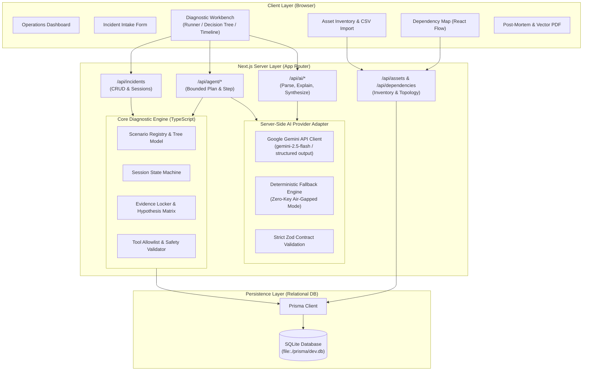

# FixFlow AI — System Architecture & Technical Design

## 1. High-Level Architecture Overview

FixFlow AI is engineered as a modern, unified Next.js App Router application built in TypeScript. It integrates an inventory-aware deterministic diagnostic engine with a bounded, server-side LLM provider adapter (Google Gemini API / local deterministic fallback).



---

## 2. Layered Architecture & Component Breakdown

### 2.1 Frontend Architecture (Presentation Layer)
- **Framework**: Next.js 15 (App Router, Server Components where advantageous, Client Components for rich interactive workbenches).
- **Styling & Tokens**: Tailwind CSS configured with enterprise IT palette:
  - Deep Navy Backgrounds (`bg-[#0B0F17]`, `bg-[#0F172A]`)
  - Slate Containers & Borders (`bg-[#1E293B]`, `border-[#334155]`)
  - Restrained Cyan & Sky Accents (`text-cyan-400`, `bg-cyan-500/10`, `border-cyan-500/30`)
  - Status Indicators: Emerald (Passed/Resolved), Amber (Inconclusive/Warning), Rose (Failed/Critical), Slate (Not Tested/Pending).
- **Component Primitives**: Radix UI primitives (`@radix-ui/react-*`), Lucide Icons (`lucide-react`), and accessible form controls.
- **Topology Graph**: `@xyflow/react` (React Flow) rendering custom nodes for infrastructure assets with directional relationship edges (`depends_on`, `hosted_on`, `routes_through`).
- **Reporting & Print Layout**: High-contrast `@media print` styling converting interactive post-mortems into multi-page vector PDFs via standard browser print.

### 2.2 Server Architecture (Application & API Layer)
- **Next.js Route Handlers (`src/app/api/...`)**:
  - `POST /api/incidents`: Incident intake, parsing, and scenario binding.
  - `GET /api/incidents/[id]`: Retrieve incident session, recorded evidence, and active tree.
  - `POST /api/incidents/[id]/step`: Record manual test outcome and advance deterministic state machine.
  - `POST /api/agent/plan`: Generate or adapt a bounded multi-step diagnostic plan.
  - `POST /api/agent/step`: Evaluate a completed probe and update hypothesis weights.
  - `POST /api/ai/parse-incident`: Transform free-text complaints into structured schema.
  - `POST /api/ai/explain-step`: Generate context-aware explanations for tests.
  - `POST /api/ai/synthesize`: Synthesize supporting vs refuting evidence.
  - `GET /api/assets` & `POST /api/assets`: Asset management and CSV bulk import.
  - `GET /api/dependencies`: Fetch infrastructure relationship graph.
- **Security & Sandboxing**: All API routes validate incoming payloads against Zod schemas. AI credentials (`GEMINI_API_KEY`) remain strictly server-side and are never serialized to client bundles.

### 2.3 Diagnostic Engine Architecture (Domain Layer)
- **Deterministic State Machine**:
  - Manages session lifecycle: `intake` $\rightarrow$ `investigating` $\rightarrow$ `root_cause_identified` $\rightarrow$ `resolved` $\rightarrow$ `closed`.
  - Evaluates recorded test outcomes: `passed`, `failed`, `inconclusive`, `not_tested`.
  - Calculates confidence adjustments for candidate hypotheses based on evidence polarity.
- **Unified Engine for Guided & Agent Modes**:
  - **Guided Mode**: Calls `engine.getNextStep(session, evidence)` to traverse the active scenario tree one step at a time.
  - **Agent Mode**: Calls `agent.proposePlan(session, evidence, assetGraph)` to construct a sequence of at most 6 read-only probes, adapting after each observation.
- **Fallback Engine**: When an incident does not match a pre-registered scenario or the AI provider is offline, the engine dynamically constructs a 4-stage L1–L7 structured diagnostic tree (Physical/Link $\rightarrow$ IP/Routing $\rightarrow$ Transport/Port $\rightarrow$ Application/Auth).

### 2.4 Data Persistence Layer
- **ORM**: Prisma ORM with SQLite database (`prisma/dev.db`).
- **Rationale for Prisma + SQLite**:
  - **Zero-Friction Solo Setup**: No Docker daemon, cloud credentials, or external DB servers required for evaluation or offline demos.
  - **Relational Integrity**: Foreign key constraints, cascading deletes, and many-to-many relationship tables (`AssetDependency`, `IncidentAsset`).
  - **Type Safety**: End-to-end auto-generated TypeScript types matching Prisma schema.
  - **Portability**: Database file can be seeded, backed up, or reset instantly.

---

## 3. Directory Structure

```
fixflow-ai/
├── docs/
│   ├── PRODUCT_SPEC.md
│   ├── ARCHITECTURE.md
│   ├── DATA_MODEL.md
│   ├── SAFETY.md
│   ├── IMPLEMENTATION_PLAN.md
│   ├── DEMO_SCRIPT.md
│   └── TEST_PLAN.md
├── prisma/
│   ├── schema.prisma              # Relational schema (Assets, Incidents, Evidence, Reports)
│   ├── seed.ts                    # Realistic demo seed data (Assets, Topologies, Scenarios)
│   └── dev.db                     # SQLite database file
├── public/
│   └── templates/                 # CSV import templates
├── src/
│   ├── app/
│   │   ├── api/
│   │   │   ├── agent/             # Bounded agent planning & step execution
│   │   │   ├── ai/                # LLM provider adapter endpoints
│   │   │   ├── assets/            # Asset inventory CRUD & CSV import
│   │   │   ├── dependencies/      # Infrastructure relationship graph
│   │   │   └── incidents/         # Incident lifecycle & workbench sessions
│   │   ├── assets/                # Asset inventory management UI
│   │   ├── dependency-map/        # React Flow infrastructure topology UI
│   │   ├── incident/
│   │   │   ├── [id]/
│   │   │   │   ├── page.tsx       # Diagnostic Workbench (Runner/Tree/Timeline)
│   │   │   │   └── report/        # Incident Post-Mortem & Vector PDF view
│   │   │   └── new/               # Natural language intake & triage
│   │   ├── investigations/        # Searchable historical incident catalog
│   │   ├── settings/              # Settings & AI provider status
│   │   ├── globals.css            # Dark enterprise IT design tokens & print styles
│   │   ├── layout.tsx             # Root layout with sidebar navigation & top bar
│   │   └── page.tsx               # Operations Dashboard
│   ├── components/
│   │   ├── assets/                # Asset tables, forms, CSV importer
│   │   ├── dependency-map/        # React Flow custom nodes & edge controls
│   │   ├── layout/                # Sidebar, header, status badges, breadcrumbs
│   │   ├── ui/                    # Reusable primitives (Buttons, Cards, Modals, Inputs)
│   │   └── workbench/             # Diagnostic runner, VisualDecisionTree, Timeline, EvidenceLocker
│   ├── lib/
│   │   ├── agent/                 # Bounded planner, loop prevention, approval gating
│   │   ├── ai/                    # Gemini adapter, fallback engine, prompt templates
│   │   ├── db/                    # Prisma client singleton
│   │   ├── engine/                # Diagnostic engine, scenario registry, hypothesis matrix
│   │   ├── safety/                # Command validator, tool allowlist, parameter sanitizers
│   │   └── utils/                 # CSV parser, formatting, error helpers
│   └── types/
│       ├── asset.ts               # Asset & relationship type definitions
│       ├── diagnostic.ts          # Steps, evidence, hypotheses, scenarios
│       ├── incident.ts            # Incident sessions, triage, RCA
│       └── safety.ts              # Tool allowlist & risk classifications
├── tailwind.config.ts
├── tsconfig.json
├── package.json
└── README.md
```

---

## 4. Non-Functional Invariants & Performance Goals

1. **Zero Client Secret Leakage**: The browser bundle never receives API keys. All LLM calls pass through Next.js server-side route handlers with Zod schema enforcement.
2. **Deterministic UI Responsiveness**: Diagnostic state transitions execute synchronously in $<50\text{ms}$. AI-assisted explanations and synthesis have a strict $10\text{s}$ timeout with fallback to deterministic knowledge.
3. **Print / Vector PDF Fidelity**: The Post-Mortem Report route (`/incident/[id]/report`) renders high-contrast, pure-white backgrounds with crisp black typography, eliminating navigation sidebars and preserving table borders on standard letter/A4 paper.
4. **Accessible Keyboard Navigation**: All diagnostic controls, copy buttons, result radio options, and tab switchers support standard tab/enter/space keyboard navigation with visible focus rings.
