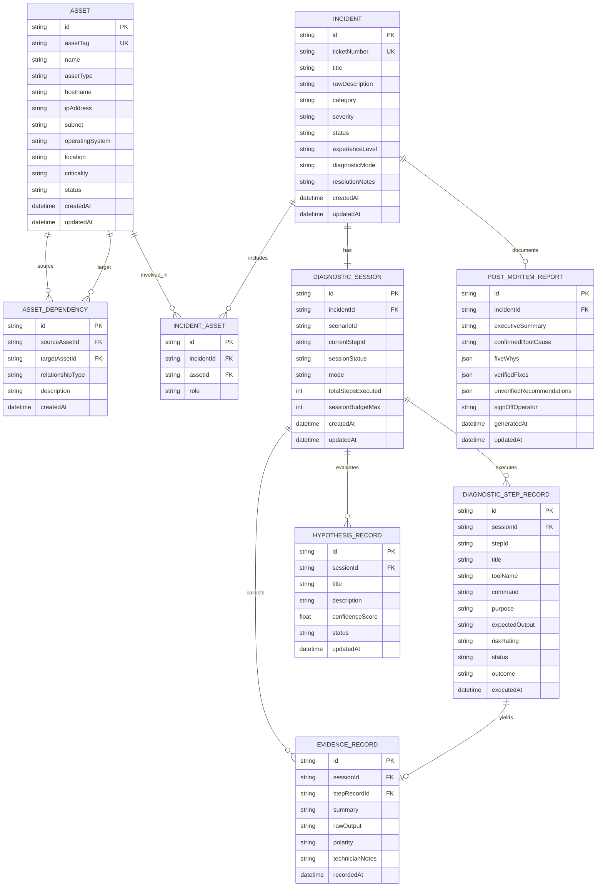

# FixFlow AI — Data Model & Schema Specifications

## 1. Relational Entity-Relationship Diagram

FixFlow AI relies on a strictly relational schema managed via Prisma with SQLite. The model links IT assets and infrastructure dependencies directly to troubleshooting sessions, recorded evidence, and post-mortem reports.



---

## 2. Complete Prisma Schema (`prisma/schema.prisma`)

```prisma
datasource db {
  provider = "sqlite"
  url      = "file:./dev.db"
}

generator client {
  provider = "prisma-client-js"
}

enum AssetType {
  SERVER
  VIRTUAL_MACHINE
  WORKSTATION
  LAPTOP
  NETWORK_DEVICE
  FIREWALL
  STORAGE
  SHARED_FOLDER
  DATABASE
  APPLICATION
  WINDOWS_SERVICE
  PRINTER
  OTHER
}

enum AssetCriticality {
  TIER_1_CRITICAL
  TIER_2_HIGH
  TIER_3_MEDIUM
  TIER_4_LOW
}

enum AssetStatus {
  OPERATIONAL
  DEGRADED
  OFFLINE
  MAINTENANCE
}

enum DependencyType {
  DEPENDS_ON
  HOSTED_ON
  CONNECTS_TO
  AUTHENTICATES_AGAINST
  ROUTES_THROUGH
}

enum IncidentSeverity {
  P1_CRITICAL
  P2_HIGH
  P3_MEDIUM
  P4_LOW
}

enum IncidentStatus {
  OPEN
  TRIAGED
  INVESTIGATING
  ROOT_CAUSE_IDENTIFIED
  RESOLVED
  CLOSED
}

enum DiagnosticMode {
  GUIDED
  AGENT
}

enum StepOutcome {
  PASSED
  FAILED
  INCONCLUSIVE
  NOT_TESTED
  SKIPPED
}

enum EvidencePolarity {
  SUPPORTING
  REFUTING
  NEUTRAL
}

enum HypothesisStatus {
  CANDIDATE
  INVESTIGATING
  CONFIRMED
  REFUTED
}

model Asset {
  id               String           @id @default(cuid())
  assetTag         String           @unique
  name             String
  assetType        AssetType
  hostname         String?
  ipAddress        String?
  subnet           String?
  operatingSystem  String?
  location         String?
  criticality      AssetCriticality @default(TIER_3_MEDIUM)
  status           AssetStatus      @default(OPERATIONAL)
  notes            String?
  createdAt        DateTime         @default(now())
  updatedAt        DateTime         @updatedAt

  outgoingDeps     AssetDependency[] @relation("SourceAsset")
  incomingDeps     AssetDependency[] @relation("TargetAsset")
  incidentLinks    IncidentAsset[]

  @@index([assetType])
  @@index([status])
}

model AssetDependency {
  id               String         @id @default(cuid())
  sourceAssetId    String
  targetAssetId    String
  relationshipType DependencyType @default(DEPENDS_ON)
  description      String?
  createdAt        DateTime       @default(now())

  sourceAsset      Asset          @relation("SourceAsset", fields: [sourceAssetId], references: [id], onDelete: Cascade)
  targetAsset      Asset          @relation("TargetAsset", fields: [targetAssetId], references: [id], onDelete: Cascade)

  @@unique([sourceAssetId, targetAssetId, relationshipType])
}

model Incident {
  id               String            @id @default(cuid())
  ticketNumber     String            @unique
  title            String
  rawDescription   String
  category         String
  severity         IncidentSeverity  @default(P3_MEDIUM)
  status           IncidentStatus    @default(OPEN)
  experienceLevel  String            @default("Intermediate")
  diagnosticMode   DiagnosticMode    @default(GUIDED)
  resolutionNotes  String?
  createdAt        DateTime          @default(now())
  updatedAt        DateTime          @updatedAt

  involvedAssets   IncidentAsset[]
  session          DiagnosticSession?
  report           PostMortemReport?

  @@index([status])
  @@index([category])
}

model IncidentAsset {
  id         String   @id @default(cuid())
  incidentId String
  assetId    String
  role       String   @default("primary_affected")

  incident   Incident @relation(fields: [incidentId], references: [id], onDelete: Cascade)
  asset      Asset    @relation(fields: [assetId], references: [id], onDelete: Cascade)

  @@unique([incidentId, assetId])
}

model DiagnosticSession {
  id                 String                 @id @default(cuid())
  incidentId         String                 @unique
  scenarioId         String?
  currentStepId      String?
  sessionStatus      IncidentStatus         @default(INVESTIGATING)
  mode               DiagnosticMode         @default(GUIDED)
  totalStepsExecuted Int                    @default(0)
  sessionBudgetMax   Int                    @default(12)
  createdAt          DateTime               @default(now())
  updatedAt          DateTime               @updatedAt

  incident           Incident               @relation(fields: [incidentId], references: [id], onDelete: Cascade)
  stepRecords        DiagnosticStepRecord[]
  evidence           EvidenceRecord[]
  hypotheses         HypothesisRecord[]
}

model DiagnosticStepRecord {
  id             String          @id @default(cuid())
  sessionId      String
  stepId         String
  title          String
  toolName       String
  command        String
  purpose        String
  expectedOutput String
  riskRating     String          @default("SAFE_READ_ONLY")
  outcome        StepOutcome     @default(NOT_TESTED)
  executedAt     DateTime        @default(now())

  session        DiagnosticSession @relation(fields: [sessionId], references: [id], onDelete: Cascade)
  evidence       EvidenceRecord?
}

model EvidenceRecord {
  id              String               @id @default(cuid())
  sessionId       String
  stepRecordId    String?              @unique
  summary         String
  rawOutput       String?
  polarity        EvidencePolarity     @default(NEUTRAL)
  technicianNotes String?
  recordedAt      DateTime             @default(now())

  session         DiagnosticSession    @relation(fields: [sessionId], references: [id], onDelete: Cascade)
  stepRecord      DiagnosticStepRecord? @relation(fields: [stepRecordId], references: [id], onDelete: SetNull)
}

model HypothesisRecord {
  id              String           @id @default(cuid())
  sessionId       String
  title           String
  description     String
  confidenceScore Float            @default(0.5)
  status          HypothesisStatus @default(CANDIDATE)
  updatedAt       DateTime         @updatedAt

  session         DiagnosticSession @relation(fields: [sessionId], references: [id], onDelete: Cascade)
}

model PostMortemReport {
  id                         String   @id @default(cuid())
  incidentId                 String   @unique
  executiveSummary           String
  confirmedRootCause         String
  fiveWhys                   String   // Stored as JSON string
  verifiedFixes              String   // Stored as JSON string
  unverifiedRecommendations  String   // Stored as JSON string
  signOffOperator            String   @default("Lead Incident Technician")
  generatedAt                DateTime @default(now())
  updatedAt                  DateTime @updatedAt

  incident                   Incident @relation(fields: [incidentId], references: [id], onDelete: Cascade)
}
```

---

## 3. Zod Schema Contracts for API Validation

### 3.1 Asset & CSV Contracts
```typescript
import { z } from 'zod';

export const AssetTypeSchema = z.enum([
  'SERVER', 'VIRTUAL_MACHINE', 'WORKSTATION', 'LAPTOP',
  'NETWORK_DEVICE', 'FIREWALL', 'STORAGE', 'SHARED_FOLDER',
  'DATABASE', 'APPLICATION', 'WINDOWS_SERVICE', 'PRINTER', 'OTHER'
]);

export const AssetCriticalitySchema = z.enum([
  'TIER_1_CRITICAL', 'TIER_2_HIGH', 'TIER_3_MEDIUM', 'TIER_4_LOW'
]);

export const AssetCreateSchema = z.object({
  assetTag: z.string().min(2).max(50),
  name: z.string().min(2).max(100),
  assetType: AssetTypeSchema,
  hostname: z.string().optional().nullable(),
  ipAddress: z.string().regex(/^(\d{1,3}\.){3}\d{1,3}(\/\d{1,2})?$/).optional().nullable(),
  subnet: z.string().optional().nullable(),
  operatingSystem: z.string().optional().nullable(),
  location: z.string().optional().nullable(),
  criticality: AssetCriticalitySchema.default('TIER_3_MEDIUM'),
  notes: z.string().optional().nullable()
});

export const AssetCsvRowSchema = z.object({
  'Asset Tag': z.string().min(1),
  'Name': z.string().min(1),
  'Type': z.string().min(1),
  'Hostname': z.string().optional(),
  'IP Address': z.string().optional(),
  'Subnet': z.string().optional(),
  'OS': z.string().optional(),
  'Location': z.string().optional(),
  'Criticality': z.string().optional()
});
```

### 3.2 Incident Intake & Triage Contracts
```typescript
export const IncidentCreateRequestSchema = z.object({
  rawDescription: z.string().min(10, "Please describe the incident in at least 10 characters"),
  targetAssetId: z.string().optional().nullable(),
  categoryOverride: z.string().optional(),
  severityOverride: z.enum(['P1_CRITICAL', 'P2_HIGH', 'P3_MEDIUM', 'P4_LOW']).optional(),
  experienceLevel: z.enum(['Beginner', 'Intermediate', 'Advanced']).default('Intermediate'),
  diagnosticMode: z.enum(['GUIDED', 'AGENT']).default('GUIDED')
});

export const IncidentTriageResponseSchema = z.object({
  ticketNumber: z.string(),
  title: z.string(),
  category: z.string(),
  severity: z.enum(['P1_CRITICAL', 'P2_HIGH', 'P3_MEDIUM', 'P4_LOW']),
  suggestedAssetTag: z.string().optional().nullable(),
  matchedScenarioId: z.string().optional().nullable(),
  provenance: z.enum(['gemini_structured', 'deterministic_fallback'])
});
```

### 3.3 Diagnostic Step Outcome & Evidence Entry
```typescript
export const StepResultSubmitSchema = z.object({
  sessionId: z.string(),
  stepId: z.string(),
  outcome: z.enum(['PASSED', 'FAILED', 'INCONCLUSIVE', 'NOT_TESTED', 'SKIPPED']),
  rawTerminalOutput: z.string().optional().nullable(),
  technicianNotes: z.string().optional().nullable(),
  observedAnomalies: z.array(z.string()).default([])
});
```

### 3.4 Bounded Agent Planning Contracts
```typescript
export const AgentPlanStepSchema = z.object({
  stepNumber: z.number().int().min(1).max(6),
  title: z.string(),
  toolName: z.enum([
    'dns_resolver_probe', 'ping_icmp_probe', 'socket_port_probe',
    'vpn_route_audit', 'mtu_path_probe', 'service_status_probe',
    'ntfs_permission_audit', 'vss_writer_audit', 'event_log_query'
  ]),
  command: z.string(),
  purpose: z.string(),
  expectedOutput: z.string(),
  riskRating: z.enum(['SAFE_READ_ONLY', 'ELEVATED_AUDIT_WARNING']),
  requiresApproval: z.boolean()
});

export const AgentPlanResponseSchema = z.object({
  planSummary: z.string(),
  primaryHypothesis: z.string(),
  confidence: z.number().min(0).max(1),
  steps: z.array(AgentPlanStepSchema).max(6),
  sessionBudgetRemaining: z.number().int(),
  provenance: z.enum(['gemini_structured', 'deterministic_fallback'])
});
```
