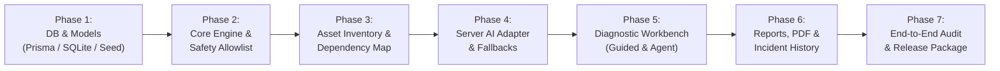

# FixFlow AI — Implementation Plan & Milestone Roadmap

## 1. Development Principles & Solo Scope Discipline

To ensure a production-grade, fully functional application within the solo hackathon timeline, the following operational rules are observed:
1. **Vertical Slice Development**: Each phase delivers fully working, end-to-end functionality backed by typed contracts and automated tests before moving to the next.
2. **Zero Synthetic / Mock Vanity Controls**: Every button, input, toggle, and link performs a real domain action or persists state.
3. **Deterministic First, AI Enhanced**: The core diagnostic engine, asset registry, and scenario models work 100% offline without API keys. Gemini adds structured generative intelligence when configured.
4. **Relational Database Grounding**: All state (assets, dependencies, incidents, evidence, reports) persists in SQLite via Prisma.

---

## 2. Phase-by-Phase Implementation Roadmap

---

### Phase 1: Project Foundation, Relational Database & Seed Data
* **Objectives**:
  - Initialize Next.js 15 App Router project structure with TypeScript, Tailwind CSS, Lucide icons, and Radix UI primitives.
  - Configure Prisma ORM with SQLite database (`prisma/schema.prisma`).
  - Create and run migration creating all relational tables (`Asset`, `AssetDependency`, `Incident`, `IncidentAsset`, `DiagnosticSession`, `DiagnosticStepRecord`, `EvidenceRecord`, `HypothesisRecord`, `PostMortemReport`).
  - Create comprehensive database seed script (`prisma/seed.ts`) populating:
    - 15 realistic enterprise IT assets (Domain Controllers, File Servers, Core Switches, Firewalls, VMs, Laptops, Printers).
    - Infrastructure dependencies (`depends_on`, `hosted_on`, `routes_through`, `authenticates_against`).
    - The 5 representative scenario models.
* **Deliverables**:
  - `prisma/schema.prisma`
  - `prisma/seed.ts`
  - `src/lib/db/prisma.ts` (Prisma client singleton)
  - Passing test verifying database queries and foreign key constraints.

---

### Phase 2: Diagnostic Domain Engine & Tool Safety Allowlist
* **Objectives**:
  - Implement deterministic diagnostic state machine (`src/lib/engine/engine.ts`).
  - Implement scenario registry linking incidents to predefined test trees (`src/lib/engine/scenarios.ts`).
  - Build the Evidence Model: recording test outcomes (`passed`, `failed`, `inconclusive`, `not_tested`), updating hypothesis confidence, and isolating branches.
  - Implement L1–L7 structured fallback generator for unknown incidents.
  - Implement strict tool allowlist and command validation (`src/lib/safety/validator.ts`) blocking shell injection and dangerous binaries.
* **Deliverables**:
  - `src/lib/engine/engine.ts`
  - `src/lib/engine/scenarios.ts`
  - `src/lib/safety/validator.ts`
  - Unit tests for state transitions, branch switching, and safety rejection (`npm test`).

---

### Phase 3: Asset Inventory & Dependency Map
* **Objectives**:
  - Implement Asset Inventory UI (`/assets`) with table search, filtering by type/status/criticality, and detail drawer.
  - Implement Asset CRUD modal and CSV bulk import with column matching and error validation.
  - Build the Infrastructure Dependency Map (`/dependency-map`) using `@xyflow/react` (React Flow):
    - Custom dark navy asset nodes with status badges and IP badges.
    - Directional relationship edges.
    - Mini-map, zoom controls, and active incident filter.
* **Deliverables**:
  - `src/app/assets/page.tsx`
  - `src/app/dependency-map/page.tsx`
  - `src/components/assets/AssetTable.tsx`, `AssetCsvModal.tsx`
  - `src/components/dependency-map/TopologyGraph.tsx`
  - `/api/assets` and `/api/dependencies` route handlers.

---

### Phase 4: Server-Side AI Provider Adapter & Fallbacks
* **Objectives**:
  - Implement server-side AI provider adapter (`src/lib/ai/adapter.ts`) integrating Google Gemini API (`@google/genai` or direct REST API via fetch with `gemini-2.5-flash`).
  - Implement four structured AI capabilities with Zod schema contracts:
    1. `parseIncident`: Convert free-text complaints into structured tickets and match assets.
    2. `explainStep`: Generate technical context, command flags, and expected outputs.
    3. `synthesizeEvidence`: Summarize supporting vs refuting telemetry without fabricating unobserved facts.
    4. `generateReport`: Draft post-mortem executive summary and 5-Whys.
  - Build the zero-key deterministic fallback engine (`src/lib/ai/fallback.ts`) ensuring 100% functionality when credentials are not configured.
* **Deliverables**:
  - `src/lib/ai/adapter.ts`
  - `src/lib/ai/fallback.ts`
  - `src/app/api/ai/*` route handlers.
  - AI resilience unit tests with mocked responses, malformed JSON, and timeouts.

---

### Phase 5: Diagnostic Workbench (Guided & Agent Modes)
* **Objectives**:
  - Build unified Diagnostic Workbench (`/incident/[id]`):
    - Center Console tab switcher: `Diagnostic Runner` | `Decision Tree` | `Timeline`.
    - Right Context Rail: `Associated Assets & Upstream Graph` | `Evidence Locker` | `Hypothesis Matrix`.
  - **Guided Mode**: Step-by-step test runner with 1-click command copying, risk badges, and manual result entry (`Passed`, `Failed`, `Inconclusive`, `Not Tested`, and raw output textarea).
  - **Agent Mode**: Bounded multi-step planner (`/api/agent/plan` and `/api/agent/step`):
    - Generates up to 6 safe probes per planning cycle.
    - Enforces 12-step session budget and loop prevention.
    - Human approval gate for elevated probes.
* **Deliverables**:
  - `src/app/incident/[id]/page.tsx`
  - `src/components/workbench/DiagnosticRunner.tsx`
  - `src/components/workbench/VisualDecisionTree.tsx`
  - `src/components/workbench/InvestigationTimeline.tsx`
  - `src/components/workbench/EvidenceLocker.tsx`
  - `src/components/workbench/HypothesisMatrix.tsx`

---

### Phase 6: Findings, Incident History & Vector PDF Reports
* **Objectives**:
  - Build searchable Incident History archive (`/investigations`) with status badges and multi-criteria filters.
  - Build Post-Mortem Report page (`/incident/[id]/report`):
    - Executive summary editor, 5-Whys causal progression, and verified fixes vs unverified recommendations.
    - Operator sign-off block.
    - Dedicated `@media print` styling generating clean vector PDFs via `window.print()`.
  - Build Operations Dashboard (`/`) linking recent incidents, asset health, and quick actions.
* **Deliverables**:
  - `src/app/page.tsx` (Operations Dashboard)
  - `src/app/investigations/page.tsx`
  - `src/app/incident/[id]/report/page.tsx`

---

### Phase 7: Settings, Release Readiness Audit & Final Polish
* **Objectives**:
  - Build Settings page (`/settings`) showing live Gemini API status, model configuration, experience tier defaults, and database reset triggers.
  - Run full release readiness checklist:
    - `npx tsc --noEmit` (0 errors)
    - `npm run lint` (0 warnings)
    - `npm test` (all unit/integration tests passing)
    - `npm run build` (production build compiled successfully)
  - Verify zero committed secrets and complete documentation.

---

## 3. Technical Risks & Scope Mitigation

| Risk | Impact | Mitigation Strategy |
| :--- | :--- | :--- |
| **LLM Provider Latency or Rate Limits** | UI freezing or failed investigations during demo | Server-side 10-second timeout with automatic fallback to deterministic knowledge engine (`provenance: 'deterministic_fallback'`). |
| **Complex Graph Rendering Overhead** | Sluggish dependency map performance | Use lightweight `@xyflow/react` with custom simplified node cards and limit initial render to 2-hop asset neighborhood. |
| **Database Setup Friction for Evaluators** | App fails to start on clean machine | Use SQLite via Prisma (`dev.db`). No PostgreSQL server or Docker needed; seeds automatically on setup. |
| **Scope Creep in Remote Remediation** | Security violations or unfinished execution tools | Strict Version A boundary: FixFlow AI generates copyable commands; the human technician executes them locally. |
