# FixFlow AI — Implementation Plan & MVP Roadmap

**Version:** 1.0.0  
**Status:** Approved for Implementation  
**Target:** Hackathon MVP & Production-Ready Diagnostic Workbench  
**Author:** Lead Product Engineer  

---

## 1. Overview & Phased Roadmap

This plan outlines the ten discrete phases required to build FixFlow AI from an empty directory to a fully functional, production-grade IT troubleshooting workbench. Each phase is self-contained with explicit acceptance criteria.

```mermaid
flowchart LR
    P1[Phase 1: Setup & Design] --> P2[Phase 2: Schemas & DB]
    P2 --> P3[Phase 3: Tools & Scenario]
    P3 --> P4[Phase 4: Shared Engine & API]
    P4 --> P5[Phase 5: Layout & Intake]
    P5 --> P6[Phase 6: Guided Mode]
    P6 --> P7[Phase 7: Agent Mode]
    P7 --> P8[Phase 8: Tree & Evidence]
    P8 --> P9[Phase 9: Report & PDF]
    P9 --> P10[Phase 10: Verification & Polish]
```

---

## 2. Phase-by-Phase Breakdown

### Phase 1: Project Setup, Tooling & Design System Foundation
- Initialize Next.js 15+ App Router project with TypeScript and Tailwind CSS.
- Configure path aliases (`@/*`), strict TypeScript compiler options, and ESLint.
- Install core UI and utility dependencies: `lucide-react`, `clsx`, `tailwind-merge`, `dexie`, `zod`.
- Build the dark-mode IT Operations design system:
  - Color palette: Slate-950/Zinc-900 background, Cyan/Emerald accents, Amber warnings, Rose errors.
  - Reusable base UI primitives: `Button`, `Card`, `Badge`, `Tabs`, `Modal`, `Tooltip`, `CodeBlock`.
- **Acceptance Criteria:**
  - Next.js dev server starts with zero errors.
  - Dark-mode IT console styling is active with accessible contrast ratios.

### Phase 2: Domain Schemas, Type Definitions & Storage Layer
- Define all core TypeScript interfaces in `src/types/incident.ts`:
  - `Incident`, `ExperienceLevel`, `IncidentCategory`, `Hypothesis`, `EvidenceItem`, `InvestigationNode`, `GuidedStep`, `AgentExecutionPlan`, `ToolDefinition`, `IncidentReport`.
- Implement compile-time and runtime Zod schemas in `src/lib/schemas/incident.ts`.
- Build the local persistence layer in `src/lib/db/index.ts` using Dexie.js (IndexedDB):
  - Stores: `incidents`, `evidence`, `auditLogs`.
  - CRUD helper methods: `saveIncident`, `getIncident`, `listRecentIncidents`, `deleteIncident`, `exportJSON`, `importJSON`.
- **Acceptance Criteria:**
  - Full CRUD operations tested in IndexedDB.
  - Incident schemas parse and validate valid and invalid inputs predictably.

### Phase 3: Tool Registry, Safe Diagnostic Simulators & Deterministic Scenario Engine
- Implement `src/lib/tools/registry.ts`:
  - Whitelist of registered read-only diagnostic tools:
    - `dns_lookup_simulator`: Resolves A, AAAA, CNAME, PTR, MX records.
    - `mtu_ping_sweep`: Simulates packet fragmentation sweeps with DF bit.
    - `port_reachability_probe`: Simulates TCP/UDP SYN/ACK responses.
    - `route_table_analyzer`: Parses default gateways, CIDR routing table collisions.
    - `windows_event_log_filter`: Parses simulated Event IDs (e.g. 1000, 7031, 4625).
- Implement command helper generator:
  - Formats safe CLI commands (PowerShell, CMD, Bash) with flag explanations, pre-flight checks, and rollback commands.
- Implement the deterministic sample scenario data in `src/lib/deterministic/sampleScenario.ts`:
  - Split-brain DNS & MTU black hole incident with pre-calculated hypothesis transitions, evidence items, and tree branches.
- **Acceptance Criteria:**
  - Tool executions run in memory with zero OS shell calls.
  - Deterministic scenario data is self-contained and loads instantaneously.

### Phase 4: Shared Diagnostic Engine & API Route Handlers
- Implement Bayesian-style hypothesis scoring and confidence engine in `src/lib/engine/scorer.ts`.
- Build Server API Route Handlers:
  - `POST /api/diagnose/guided`: Evaluates evidence and selects the next highest-information-gain test.
  - `POST /api/diagnose/agent`: Formulates a bounded 4–6 step plan and evaluates sequential execution.
  - `POST /api/tools/execute`: Validates tool args via Zod and returns structured tool results.
- Implement LLM Gateway with Structured Outputs:
  - Provider integration with strict JSON schemas.
  - Graceful fallback to deterministic/local engine when no API keys are present.
- **Acceptance Criteria:**
  - Both `/api/diagnose/guided` and `/api/diagnose/agent` return strictly validated JSON matching schemas.
  - Application works seamlessly without an API key configured.

### Phase 5: Incident Intake & Workbench Layout
- Build Incident Intake Page (`src/app/incident/new/page.tsx`):
  - Quick Form with Category (12 domains), Experience Level (Beginner / Intermediate / Advanced), Severity, Blast Radius.
  - Raw Symptom Log Paste tab with auto-parsing.
  - "Launch Deterministic Demo Scenario" one-click button.
- Build Tri-Pane Workbench Container (`src/components/workbench/`):
  - **Left Panel (Context & Evidence Locker):** Metadata, environment stats, live evidence list with impact badges.
  - **Center Panel (Execution):** Mode switcher (Guided vs Agent), active diagnostic cards.
  - **Right Panel (Knowledge & Tree):** Interactive Investigation Tree and Hypothesis Matrix.
- **Acceptance Criteria:**
  - Responsive tri-pane layout with collapsible side panels.
  - Intake creates new incident and immediately navigates to workbench.

### Phase 6: Guided Mode UI & Adaptive Question Runner
- Implement `src/components/guided/GuidedStepCard.tsx`:
  - Step objective and explanation tailored to selected experience level.
  - Suggested command generator with 1-click copy and pre-flight notes.
  - Response controls: `Yes (Observed)`, `No (Not Observed)`, `Inconclusive / Unknown`, and `Paste Terminal Output`.
- Terminal output parser modal:
  - Auto-extracts IPs, status codes, and error messages from user-pasted terminal sessions.
- Real-time hypothesis confidence updates and animation triggers.
- **Acceptance Criteria:**
  - User can complete an adaptive step in <3 clicks.
  - Pasted terminal output correctly alters hypothesis confidence.

### Phase 7: Agent Mode UI & Bounded Multi-Step Execution Loop
- Implement `src/components/agent/AgentPlannerView.tsx`:
  - Multi-step timeline visualizing planned steps (e.g., Step 2 of 4).
  - Safety controls: `Play All`, `Next Step (Single-Step)`, `Pause`, `Cancel`.
  - Step limit badge: `Bounded: Max 6 Steps`.
- Collapsible step log viewer showing tool invocations, stdout telemetry, and intermediate reasoning.
- Safe interrupt handling and manual hypothesis override controls.
- **Acceptance Criteria:**
  - Agent cannot exceed configured step limit.
  - User can pause or advance step-by-step.

### Phase 8: Interactive Investigation Tree & Evidence Locker
- Implement `src/components/tree/InvestigationTree.tsx`:
  - Interactive SVG/Canvas hierarchical graph.
  - Color-coded node statuses: Blue (Symptom), Slate (Tentative Hypothesis), Green (Confirmed Root Cause), Red/Strikethrough (Refuted Hypothesis), Cyan (Diagnostic Test).
  - Interactive node clicking: reveals associated evidence and justification drawer.
- Evidence Locker component (`src/components/evidence/EvidenceLocker.tsx`):
  - Filter by source (CLI, user input, system log).
  - "Add Manual Evidence" modal for user-discovered artifacts.
- **Acceptance Criteria:**
  - Tree updates dynamically as steps are executed.
  - Clicking any node displays the underlying evidence trail.

### Phase 9: Incident Post-Mortem Report Generator & PDF Export
- Implement Report View (`src/app/incident/[id]/report/page.tsx`):
  - Executive Brief, Incident Timeline, 5-Whys Root Cause Analysis, Remediation Commands with Pre-flight/Rollback, and Future Prevention Checklist.
- Build client-side PDF export bridge:
  - Dedicated print stylesheet (`@media print`) and automatic PDF trigger button.
  - High-resolution, branded multi-page document formatting.
- **Acceptance Criteria:**
  - One-click PDF download generates an IT Post-Mortem document with no visual artifacts or cutoffs.

### Phase 10: Verification, End-to-End Testing & Polish
- Full walkthrough of the Deterministic Sample Scenario (Split-Brain DNS & MTU Black Hole).
- Test all 12 categories, all 3 experience levels, and switching between Guided and Agent modes.
- Verify IndexedDB persistence: page refresh preserves all tree nodes, evidence, and hypothesis scores.
- Test edge cases: malformed JSON recovery, empty search states, responsive tablet layouts.
- **Acceptance Criteria:**
  - 100% of features in the product spec function reliably without uncaught exceptions.
  - Zero arbitrary shell commands spawned.

---

## 3. Technical Risks & Mitigation Strategies

| Risk | Impact | Mitigation Strategy |
|---|---|---|
| **LLM Output Hallucination / Schema Drift** | High | Enforce strict JSON Schema (`responseSchema`). Wrap all parsing in Zod with safe fallback defaults. |
| **Missing API Keys during Hackathon Review** | Critical | Provide the built-in Deterministic Sample Scenario and local mock engine that runs 100% offline. |
| **Shell Command Security Vulnerabilities** | Critical | Completely eliminate `child_process` and shell execution. Use client-side safe regex parsers and command review cards. |
| **Browser Print / PDF Rendering Inconsistencies** | Medium | Use strict `@media print` CSS rules, page-break controls (`break-inside: avoid`), and standardized letter/A4 container layouts. |
| **IndexedDB Storage Quotas or Private Browsing Limits** | Low | Store lightweight JSON objects and plain text logs; provide easy JSON export/import for backup. |
