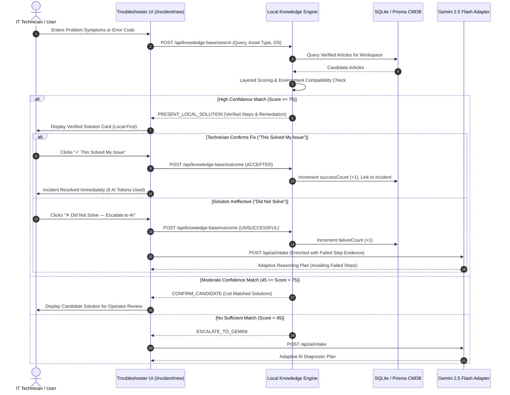

# FixFlow AI — Local Error & Solution Knowledge Base

FixFlow AI includes a high-performance, deterministic **Local Error & Solution Knowledge Base**. Designed with a **local-first troubleshooting philosophy**, it ensures that previously solved issues and verified IT remediation procedures are evaluated **before** invoking external Gemini AI reasoning.

This architecture delivers sub-100ms instantaneous resolution for known issues, eliminates recurring API costs for common corporate incidents, operates completely offline without internet connectivity, and maintains closed-loop technician outcome telemetry.

---

## 1. System Architecture & Workflow

The Knowledge Base serves as the first-line triage layer for all incoming technical problems.



---

## 2. Multi-Layered Scoring Algorithm

The matching engine employs a layered scoring model that weights exact technical indicators higher than loose keyword overlap:

| Layer | Criteria | Point Allocation | Description |
| :--- | :--- | :--- | :--- |
| **Layer A** | **Exact Error Code** | **+55 pts** | Exact normalized match on codes like `0x80070035`, `NXDOMAIN`, `EVENT_7000`, `PG_CONN_REFUSED`. Partial substring match awards **+45 pts**. |
| **Layer B** | **Normalized Statement** | **+35 pts** | Exact match between query and article `normalizedError`. Substring match awards **+25 pts**. |
| **Layer C** | **Title Keyword Coverage** | **Up to +25 pts** | Evaluates the percentage of core title tokens matched in the user's input ($Coverage \times 30$, capped at 25). |
| **Layer C** | **Token Jaccard Overlap** | **Up to +25 pts** | Token Jaccard similarity across description, symptoms, and product tokens ($Jaccard \times 50$, capped at 25). |
| **Layer D** | **Asset Type Compatibility** | **+10 pts** | Exact match on registered target asset type (`SERVER`, `ROUTER`, `PRINTER`, etc.). |
| **Layer D** | **Operating System Match** | **+8 pts** | Host OS family compatibility (`Windows Server 2022`, `Ubuntu Linux`, etc.). |
| **Layer D** | **Admin Verification** | **+5 pts** | Solution was reviewed and signed off by a Senior Systems Administrator. |
| **Layer E** | **Historical Success Ratio** | **+7 or -10 pts** | Articles with $\ge 80\%$ technician acceptance over $\ge 3$ uses get **+7 pts**. Articles with $< 30\%$ success are penalized **-10 pts**. |

### Confidence Classification
- **`HIGH` ($\ge 75$ pts)**: Presented immediately with verified diagnostic verification steps and remediation commands.
- **`MODERATE` ($45 - 74$ pts)**: Presented as candidate solutions for operator review and confirmation.
- **`LOW` ($< 45$ pts)**: Automatically escalates to Gemini AI reasoning or deterministic scenario fallbacks.

---

## 3. Strict Environment Compatibility Verification

A solution is never recommended based on textual similarity alone if it conflicts with the physical target asset:

```typescript
// Strict compatibility gate:
1. Target Asset Type: A printer problem cannot match a router gateway article.
2. Target Operating System: A Windows PowerShell / registry solution cannot match a Linux host.
```

If an asset has operating system `Ubuntu Linux 22.04 LTS`, any Windows-specific solution (e.g. `0x80070035`, `LanmanWorkstation`) is strictly marked `isCompatible: false` and filtered out, preventing dangerous command suggestions on the wrong operating system.

---

## 4. Verification Boundary & Lifecycle

Every article in FixFlow AI exists within a governed lifecycle:

```
[ TECHNICIAN INPUT / RESOLVED INCIDENT ]
                   │
                   ▼
               ┌───────┐
               │ DRAFT │ <─── Technician-submitted or incident-promoted
               └───────┘
                   │
         [ Admin Verification ]
                   ▼
              ┌──────────┐
              │ VERIFIED │ <─── Eligible for automated first-line triage
              └──────────┘
                   │
          [ Soft-Deprecation ]
                   ▼
              ┌──────────┐
              │ ARCHIVED │ <─── Excluded from search recommendations
              └──────────┘
```

- **Verification Boundary**: Only articles with `status: 'VERIFIED'` and `confidenceBasis: 'ADMIN_VERIFIED'` qualify for automatic first-line `HIGH` confidence triage.
- **Draft Articles**: Technicians can review and search drafts explicitly (`verifiedOnly: false`), but drafts never interrupt the first-line intake flow.

---

## 5. Duplicate Detection Engine

To prevent knowledge fragmentation and redundant articles, FixFlow AI runs an automated duplicate check before saving:

```typescript
POST /api/knowledge-base/duplicate-check
{
  "title": "SMB Network Path Not Found (0x80070035) on Windows Share",
  "errorCode": "0x80070035",
  "originalErrorDescription": "Clients fail to open file shares..."
}
```

- **Similarity Score $\ge 80\%$**: Recommends `UPDATE_EXISTING` (preventing duplicate creation).
- **Similarity Score $60\% - 79\%$**: Recommends `WARN_DUPLICATE` (alerts technician to review the existing solution).
- **Similarity Score $< 60\%$**: Recommends `CREATE_NEW`.

---

## 6. Closed-Loop Outcome Telemetry

FixFlow AI tracks the real-world efficacy of every knowledge base article:

```typescript
POST /api/knowledge-base/outcome
{
  "articleId": "kb-101",
  "incidentId": "INC-2026-0842",
  "outcome": "ACCEPTED" // or "UNSUCCESSFUL"
}
```

- **`ACCEPTED`**: Increments `successCount` by 1, records `lastUsedAt`, updates the incident status to `RESOLVED`, and records audit provenance.
- **`UNSUCCESSFUL`**: Increments `failureCount` by 1. The application preserves the technician's observed diagnostic step results and immediately escalates to Gemini AI intake, injecting the failed local solution into the prompt so the AI **does not repeat failed steps**.

---

## 7. REST API Reference

| Method | Endpoint | Description |
| :--- | :--- | :--- |
| `GET` | `/api/knowledge-base` | List articles with search and multi-criteria filters (`category`, `status`, `assetType`). |
| `POST` | `/api/knowledge-base` | Create a new knowledge base article with Zod schema validation. |
| `GET` | `/api/knowledge-base/:id` | Retrieve single article details and linked incident statistics. |
| `PUT` | `/api/knowledge-base/:id` | Update article details and auto-refresh normalized search tokens. |
| `DELETE` | `/api/knowledge-base/:id` | Soft-archive an article (`status: 'ARCHIVED'`). |
| `POST` | `/api/knowledge-base/:id/verify` | Promote article from `DRAFT` to `VERIFIED` (Admin workflow). |
| `POST` | `/api/knowledge-base/search` | Execute local layered search without external API dependencies. |
| `POST` | `/api/knowledge-base/outcome` | Submit technician feedback (`ACCEPTED` / `UNSUCCESSFUL`). |
| `POST` | `/api/knowledge-base/duplicate-check` | Check for existing similar articles before creation. |
| `GET` | `/api/knowledge-base/stats` | Aggregated statistics (total articles, verified %, reuse counts, top solutions). |

---

## 8. Safety & Security Invariants

1. **Read-Only Local Execution**: Step commands are executed manually by the technician inside their environment. The application never executes arbitrary remote shell commands.
2. **Credential Redaction**: Passwords, Kerberos tickets, and secret tokens are stripped from stored error text and diagnostic output.
3. **Workspace Multi-Tenancy Isolation**: All article lookups, searches, and outcome reports are scoped to the active workspace (`where: { workspaceId }`).
4. **Complete Offline Autonomy**: The local knowledge base operates with zero network dependency on Google Gemini or external services.
