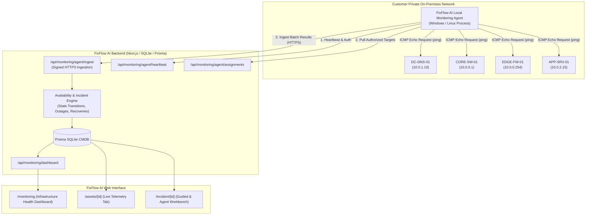

# FixFlow AI — Infrastructure Availability Monitoring (ICMP Echo)

This document details the architecture, security guarantees, data models, local agent deployment, and integration of the **ICMP Infrastructure Availability Monitoring** module for FixFlow AI.

---

## 1. Architecture Overview

FixFlow AI monitors on-premises enterprise assets using a **split-plane architecture**:



### Core Architecture Principles
1. **No Cloud-to-LAN Pinging**: Web request threads never execute shell pings directly against private LAN subnets.
2. **Authorized Pull Model**: The local agent pulls only authorized assignments configured in its assigned workspace.
3. **Signed & Authenticated Ingestion**: The agent authenticates every ingestion batch with a revocable cryptographic token (`ffa_agent_...`).
4. **Separation of Measurement Provenance**: Real local agent measurements (`REAL_AGENT`) are strictly distinguished from synthetic demo simulation results (`SIMULATION`).

---

## 2. Status Model & State Transitions

FixFlow AI maintains a deterministic availability state model:

| Status | Meaning & Criteria | Action Taken |
| :--- | :--- | :--- |
| **`ONLINE`** | Received valid ICMP Echo Reply within configured timeout. Latency and loss within thresholds. | Resets failure counters. Recovers active outage incident if consecutive successes $\ge$ `recoveryThreshold`. |
| **`DEGRADED`** | Target responds, but average latency exceeds `latencyWarningMs` (e.g. $> 100\text{ms}$) or packet loss exceeds `packetLossWarningPercent` (e.g. $> 20\%$). | Marked `DEGRADED` with explicit latency/loss delta reason. |
| **`OFFLINE`** | Target failed consecutive ICMP probes reaching `failureThreshold` (default: 3 missed pings). | Declares `OFFLINE`. Triggers or updates `AvailabilityIncident` with derived severity. |
| **`UNKNOWN`** | No recent trustworthy measurement exists (e.g., assigned monitoring agent stopped sending heartbeats for $> 3\text{ minutes}$). | State transitions to `UNKNOWN` with stale-agent reason notice. |
| **`MAINTENANCE`** | Asset is within an active maintenance window (`maintenanceUntil > now`) or alert suppression is enabled. | Outage incident creation is suppressed. State marked `MAINTENANCE`. |

> [!IMPORTANT]
> **Single Ping Invariant**: A single dropped packet or timeout does **not** immediately mark an asset `OFFLINE`. The consecutive failure threshold must be reached before declaring an outage.

> [!NOTE]
> **Epistemic Reachability Boundary**: A successful ICMP Echo Reply proves network-layer reachability from the monitoring prober, not application or service health. A server answering ICMP may still have a crashed SQL database or corrupted print spooler. Conversely, a timeout does not prove the server is powered off.

---

## 3. Database Schema Extensions

The existing database schema in [`prisma/schema.prisma`](file:///d:/Personal/Developer/fixflow-ai/prisma/schema.prisma) was extended with six tightly coupled models:

1. **`MonitoringAgent`**: Stores registered probers, platforms (`win32`, `linux`), versions, last heartbeat, and cryptographic token hashes.
2. **`AssetMonitoringConfiguration`**: 1-to-1 with `Asset`, storing target IP, polling interval, timeout, packet count, failure/recovery thresholds, latency/loss warnings, and maintenance suppression.
3. **`AssetAvailabilityState`**: 1-to-1 with `Asset`, maintaining current status (`ONLINE`, `DEGRADED`, `OFFLINE`, `UNKNOWN`, `MAINTENANCE`), consecutive failure/success counters, last check timestamp, and last transition reason.
4. **`MonitoringCheckResult`**: Timeseries append-only log of probe telemetry (latency, packet loss, packets sent/received, timestamps, and provider: `REAL_AGENT` vs `SIMULATION`).
5. **`AvailabilityIncident`**: Tracked infrastructure outages created when consecutive failures cross the threshold. Records first failure, threshold crossing, latest failure, recovery timestamp, and outage duration in seconds.
6. **`MonitoringAuditEvent`**: Immutable security audit trail recording agent registrations, token revocations, config updates, state transitions, and incident recoveries.

---

## 4. Local Monitoring Agent

The agent is located in [`agent/`](file:///d:/Personal/Developer/fixflow-ai/agent/) and has a minimal attack surface.

### Responsibilities
- Securely registers or pairs with FixFlow AI using an agent key.
- Fetches only the authorized target assignments for its ID.
- Executes ICMP Echo Requests without shell concatenation (`child_process.spawn(['-n', '3', targetIp])`).
- Enforces strict regex validation on all target IP addresses.
- Transmits batches with bounded retries and backoff.
- In-memory buffering of telemetry during transient network disconnections.
- Redacts secret keys from console logs (`ffa_agent_...` $\rightarrow$ `ffa_agen...y_v1`).

### Running the Local Agent

```powershell
# Single-pass execution (audits targets once and exits):
npx tsx agent/index.ts --once --server http://localhost:3000 --agent-id agent-win11-ops --key ffa_agent_demo_win11_ops01_lan_prober_key_v1

# Continuous daemon execution (polls on configured schedule):
npx tsx agent/index.ts --server http://localhost:3000 --agent-id agent-win11-ops --key ffa_agent_demo_win11_ops01_lan_prober_key_v1 --interval 30 --concurrency 5
```

### Platform Compatibility & Permissions
- **Windows (`win32`)**: Uses native Windows `ping.exe`. Does **not** require elevated administrator privileges.
- **Linux (`linux`)**: Uses standard `ping -c <count> -W <timeout>`. Standard user accounts with `CAP_NET_RAW` or unprivileged ping sockets (`net.ipv4.ping_group_range`) are supported.

---

## 5. Security & Network Safety

1. **Zero Remote Execution**: The agent **never** accepts arbitrary shell commands, scripts, or AI-generated commands. It only executes ICMP Echo Requests.
2. **Target Isolation**: Targets must be explicitly registered and saved in the workspace asset inventory. The agent rejects unassigned or unregistered IPs.
3. **Anti-Scanning Safeguard**: No subnet sweeps, broadcast sweeps, port scans, or network discovery tools are included or allowed.
4. **Clock Skew & Timestamp Validation**: The server rejects results timestamped $> 60\text{s}$ in the future or older than $24\text{ hours}$.
5. **Revocable Credentials**: Monitoring agent tokens can be revoked immediately from `/api/monitoring/agents/[id]` or the UI.

---

## 6. FixFlow AI Diagnostics Integration

Monitoring data is automatically supplied to both **Guided Mode** and **Agent Mode** during incident investigations:

- **Intake Triage (`/api/ai/intake`)**: Automatically queries target asset availability and dependency health.
- **Next-Step Reasoning (`/api/ai/next-step`)**: Ingests fresh telemetry into the LLM context.
- **Diagnostic Workbench (`/incident/[id]`)**: Renders a dedicated **Live ICMP Availability Telemetry Card** displaying the current status, latency, packet loss, and correlation warnings.
- **Dependency Correlation**: If the target and multiple upstream nodes (e.g. gateway and core switch) fail ICMP checks, the UI highlights:
  > *Correlated reachability failure: Target and upstream dependency nodes are failing availability checks. Prioritizing upstream switch/routing triage.*
- **Reachability vs Service Disambiguation**: If an asset responds to ping but an application or file share fails, the AI explains that network reachability does not guarantee application health and proposes service-layer tests.

---

## 7. Verification & Automated Test Coverage

The entire monitoring module is covered by automated unit and integration tests in:
- [`src/lib/services/__tests__/monitoringService.test.ts`](file:///d:/Personal/Developer/fixflow-ai/src/lib/services/__tests__/monitoringService.test.ts)
- [`agent/__tests__/icmpProber.test.ts`](file:///d:/Personal/Developer/fixflow-ai/agent/__tests__/icmpProber.test.ts)

Run the full test suite:
```bash
npm test
```
Result: **77 / 77 passing across 32 suites in under 2 seconds**.
