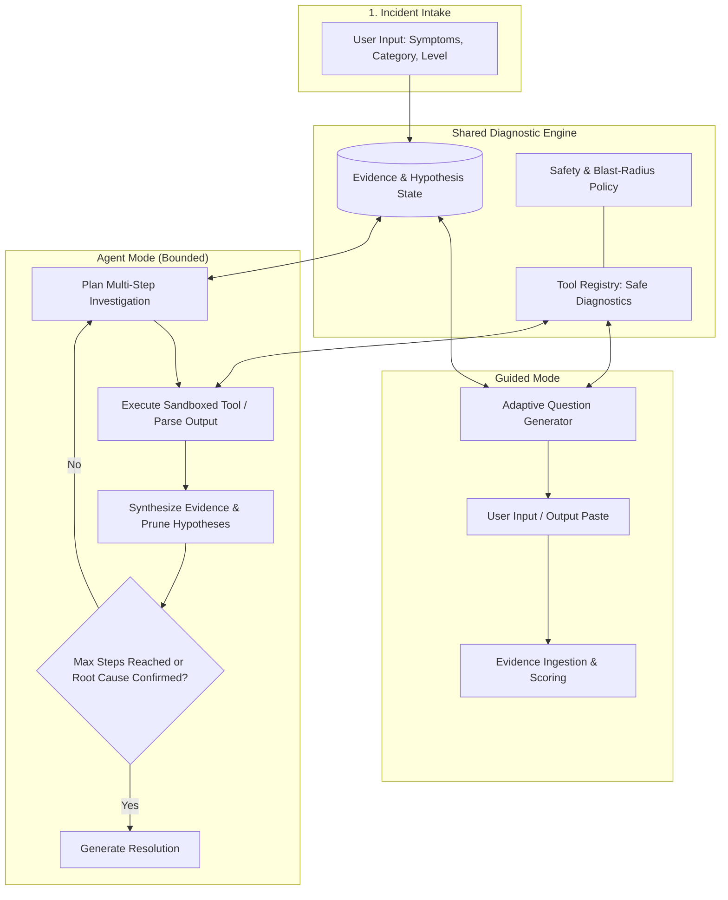

# FixFlow AI — Product Specification

**Version:** 1.0.0  
**Status:** Approved for Implementation  
**Target:** Hackathon MVP & Production-Ready Diagnostic Workbench  
**Author:** Lead Product Engineer  

---

## 1. Executive Summary & Vision

**FixFlow AI** is a purpose-built IT troubleshooting workbench designed to replace chaotic, unstructured terminal notes and generic AI chatbots with a disciplined, evidence-based diagnostic console. 

In real-world IT operations—from Tier-1 service desk technicians to Tier-3 infrastructure engineers—troubleshooting often fails due to hasty assumptions, untracked evidence, disjointed log pastes, and risky copy-pasted commands. Generic chat interfaces exacerbate this problem: they lack structured state, hallucinate root causes without verification, and encourage dangerous autonomous shell executions.

FixFlow AI bridges this gap with:
1. **Evidence-Driven Investigation:** Treating every diagnostic idea strictly as a hypothesis until confirmed by verifiable artifacts.
2. **Dual-Mode Engine:** Seamlessly switching between **Guided Mode** (step-by-step, adaptive questions for junior technicians) and **Agent Mode** (bounded, multi-step autonomous planning for seasoned engineers).
3. **Interactive Visual Topology:** A dynamic investigation tree that visualizes symptoms, tested hypotheses, evidence linkages, and confirmed root causes in real time.
4. **Safety & Verification First:** Complete guardrails preventing uncontrolled shell commands or autonomous system modifications, paired with a deterministic offline mode for bulletproof demos and air-gapped environments.

---

## 2. Target Personas & Experience Levels

FixFlow AI adapts its terminology, diagnostic verbosity, tooling recommendations, and safety explanations based on the user's declared proficiency level:

| Experience Level | Target Persona | Diagnostic UX Behavior | Output & Command Style |
|---|---|---|---|
| **Beginner** | End users, junior helpdesk analysts, trainees | Highly guided, conversational explanations of *why* a test is needed. Minimal jargon. Emphasizes visual checks and copy-pasteable safe read-only commands with clear explanations of what output to look for. | Plain-English summaries, safe one-line command helpers with detailed walkthroughs, heavy guardrail warnings. |
| **Intermediate** | IT support specialists, system administrators, field techs | Accelerated triage, structured hypothesis testing, quick log interpretation. Focuses on efficient command sequences, network traces, and OS event log filtering. | Direct CLI/PowerShell/Bash snippets, flags explained succinctly, side-by-side evidence comparison. |
| **Advanced** | Senior sysadmins, SREs, network engineers, security analysts | Unbounded hypothesis exploration, raw telemetry/packet inspection, multi-vector graph analysis, and rapid root cause synthesis. | Dense telemetry views, raw regex/log filters, architectural impact analysis, and formal RCA generation. |

---

## 3. Incident Category Taxonomy

FixFlow AI organizes diagnostic logic, tool registries, and pre-built symptom catalogs into 12 primary IT domains:

```
┌────────────────────────────────────────────────────────────────────────┐
│                   FIXFLOW AI DOMAIN TAXONOMY                          │
├────────────────────┬────────────────────┬──────────────────────────────┤
│ 1. Networking      │ 5. Windows OS      │  9. Email & Collaboration    │
│ 2. DNS             │ 6. Accounts & Perms│ 10. Backup & Storage         │
│ 3. VPN             │ 7. Apps & Services │ 11. Printers & Peripherals   │
│ 4. Firewall        │ 8. Virtualization  │ 12. Endpoint & Security      │
└────────────────────┴────────────────────┴──────────────────────────────┘
```

1. **Networking:** L1–L4 connectivity, routing loops, default gateways, MTU clamping, packet drop, duplex mismatches, DHCP exhaustion.
2. **DNS:** Resolution failures, TTL caching issues, split-brain DNS, missing PTR/CNAME records, authoritative vs. recursive timeouts.
3. **VPN:** IPsec/WireGuard/OpenVPN tunnel negotiation, phase 1/phase 2 failures, split tunneling route leaks, MTU/MSS black hole issues.
4. **Firewall:** Stateful inspection drops, inbound/outbound ACLs, NAT translation table exhaustion, deep packet inspection (DPI) certificate rejections.
5. **Windows:** Event Viewer (System, Application, Security), Service Control Manager (SCM), Registry anomalies, WMI/CIM errors, BSOD stop codes.
6. **Accounts & Permissions:** Active Directory lockouts, Kerberos ticket expiration, NTFS/POSIX ACLs, IAM role misconfigurations, MFA desync.
7. **Applications & Services:** Process crashes, memory leaks, port collisions (e.g., port 80/443/8080 already bound), missing runtime dependencies (.NET, Visual C++, Java).
8. **Servers & Virtualization:** Hypervisor contention (VMware ESXi, Hyper-V, Proxmox), vCPU overcommit, balloon memory pressure, storage IOPS starvation.
9. **Email:** SMTP relay rejections, MX lookup failures, SPF/DKIM/DMARC alignment errors, TLS handshake mismatches, mailbox database dismounts.
10. **Backup & Storage:** VSS (Volume Shadow Copy) provider errors, snapshot timeouts, NAS/SAN iSCSI target drops, LUN capacity exhaustion.
11. **Printers & Peripherals:** Spooler RPC service crashes, driver isolation conflicts, RAW/LPR port timeouts, USB controller bus resets.
12. **Endpoint & Security Incidents:** Suspicious outbound beaconing, unauthorized registry startup items, EDR containment status, certificate expiration.

---

## 4. Core Product Requirements & MVP Scope

### 4.1 Incident Intake
- **Dual Intake Modes:** Quick Form (guided dropdowns for Category, Experience Level, Severity, Blast Radius) vs. Raw Symptom Log Paste (AI auto-extracts symptoms, environment, and error codes).
- **Blast Radius Tagging:** Individual User, Workgroup / Department, Branch Office, Entire Enterprise / Critical Infrastructure.
- **Urgency Matrix:** P1 (Outage / Revenue Impact), P2 (Degraded High Priority), P3 (Standard Impairment), P4 (Minor / Inquiry).
- **Environment Context:** OS (Windows, macOS, Linux, Hybrid), Network Zone (Corp LAN, Remote/VPN, Cloud VPC, DMZ).

### 4.2 Diagnostic Workbench (Console Layout)
The UI avoids generic centered chat bubbles in favor of an **IT Operations Control Room** layout:
- **Left Panel (Incident Context & Evidence Locker):**
  - Incident metadata, active symptoms, and live blast radius.
  - Evidence Locker: List of collected artifacts (terminal outputs, ping stats, log snippets, screenshot notes) with verifiable status tags.
  - Quick action toolbar: Add manual evidence, clear session, export snapshot.
- **Center Panel (Diagnostic Engine Execution):**
  - Mode Switcher: Guided Mode vs. Agent Mode.
  - Guided Mode view: Interactive Step Card (current question, diagnostic reasoning, safe command generator with copy button, test response buttons: *Yes / No / Inconclusive / Paste CLI Output*).
  - Agent Mode view: Bounded Plan Pipeline (e.g., Step 2 of 4), Autonomous Step Feed with collapsible tool execution results, hypothesis re-evaluations, and pause/resume/step-over controls.
- **Right Panel (Investigation Tree & Hypothesis Matrix):**
  - Interactive SVG/Canvas-based Investigation Tree visualizing nodes: `Symptom` ➔ `Hypothesis` ➔ `Diagnostic Test` ➔ `Evidence` ➔ `Verified Root Cause`.
  - Hypothesis Confidence Matrix: Dynamic probability bars (0–100%), status badges (*Active, Confirmed, Refuted, Pending Evidence*).
  - Remediation Action Deck: Step-by-step verified fix instructions with diffs and rollback plans once root cause is established.

### 4.3 Dual Diagnostic Modes (Shared Engine)
Both modes share the identical underlying state machine, evidence model, and safety policy:



#### Guided Mode
- Emits **one test/question at a time**.
- Based on the user's answer or pasted terminal output, the shared engine evaluates evidence, recalculates Bayesian-style confidence for all hypotheses, and selects the single most informative next diagnostic test (Highest Information Gain).
- Prevents cognitive overload for junior operators.

#### Agent Mode
- Emits a **bounded multi-step investigation plan** (default 4–6 steps, max 8 steps).
- For each step, the agent simulates or executes safe read-only tools, inspects evidence, records intermediate observations, and dynamically revises subsequent steps if new data invalidates earlier assumptions.
- Includes safety interrupts: user can pause, inspect reasoning, skip steps, or override hypothesis scores at any time.

### 4.4 Evidence & Hypothesis Tracking
- **Hypothesis Model:**
  - `id`, `title`, `description`, `category`, `probability` (0.0 to 1.0), `status` (`tentative`, `likely`, `confirmed`, `refuted`), `supportingEvidenceIds`, `refutingEvidenceIds`.
- **Evidence Item Model:**
  - `id`, `timestamp`, `source` (`user_input`, `command_output`, `log_file`, `tool_result`), `type` (`terminal`, `metric`, `boolean`, `text`), `rawPayload`, `summary`, `confidenceImpact`.
- Mathematical sanity check: hypotheses are dynamically re-ranked based on evidence weight. No hypothesis can be labeled `confirmed` without at least one verifiable supporting evidence artifact.

### 4.5 Findings & Incident Post-Mortem Report
Upon reaching a confirmed root cause (or user-initiated report generation), FixFlow AI produces an enterprise-grade Incident Post-Mortem:
- **Executive Summary:** Plain-language incident brief for non-technical stakeholders.
- **Incident Timeline:** Millisecond-accurate chronology of symptoms reported, tests executed, and evidence discovered.
- **Root Cause Analysis (RCA):** The 5-Whys analysis and technical failure mechanism.
- **Corrective Action & Remediation:** Reviewed fix commands with explicit pre-flight checks and rollback instructions.
- **Preventative Measures:** Long-term architectural or policy recommendations to prevent recurrence.

### 4.6 PDF Export
- Generates a beautifully styled, branded, and print-ready PDF document directly in the browser.
- Includes table of contents, timeline graphic, evidence attachments, and signature blocks for IT compliance sign-off.

### 4.7 Local Incident Persistence (IndexedDB)
- 100% offline-first architecture powered by IndexedDB.
- Stores full incident sessions, snapshot history, custom notes, and evidence logs.
- Features an Incident Drawer / History Browser: resume ongoing diagnostics, view past resolved incidents, or export/import JSON incident packages.

### 4.8 Deterministic Sample Scenario (Judge & Offline Ready)
- Built-in, high-fidelity offline scenario: **"VPN Connected but Internal Production Database & Intranet Unreachable (Split-Brain DNS & MTU Clamping Failure)"**.
- Runs completely without external LLM API keys or internet connection.
- Demonstrates full Guided Mode and Agent Mode workflows, terminal output parsing, hypothesis pruning, investigation tree animation, and PDF generation with 100% deterministic reliability.

---

## 5. Non-Functional Requirements & Design Principles

1. **Zero Fake Chat:** Avoid standard chat bubbles. Every diagnostic action is an interactive card, form, or visual graph node.
2. **Speed & Responsiveness:** Instant UI updates (<50ms for local state transitions); streaming or progressive loading states for LLM reasoning steps.
3. **Graceful Degradation:** If LLM API credentials are not provided or network errors occur, the system immediately offers the deterministic sample runner or manual diagnostic mode without breaking.
4. **Accessibility:** WCAG 2.1 AA compliant colors, accessible form fields, keyboard navigation for modal dialogues, and screen-reader-friendly status indicators.
5. **Mobile / Responsive Layout:** Collapsible panels that scale down seamlessly from 4K ultrawide displays to tablets and laptops.
