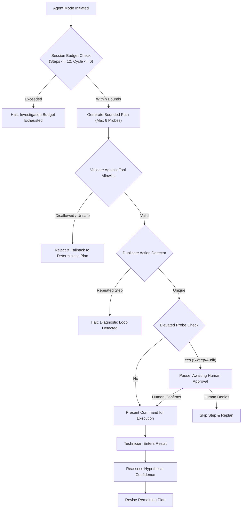

# FixFlow AI — Safety, Sandboxing & Threat Model

## 1. Safety Manifesto

In an enterprise IT environment, an autonomous AI tool executing commands on production networks is a severe operational risk. Premature service restarts can cause cascading cluster failovers, accidental firewall rule changes can lock out administrators, and speculative script execution can cause data loss.

**FixFlow AI enforces a strict Version A Air-Gapped / Human-in-the-Loop Safety Policy:**
1. **Zero Autonomous Remote Command Execution**: FixFlow AI does not establish SSH, WinRM, PowerShell Remoting, WMI, or agent socket connections to endpoints. It cannot execute code on infrastructure.
2. **Human Operator in Full Control**: FixFlow AI generates verified, read-only diagnostic command strings for the human engineer to review, copy, execute locally on their own terminal, and manually record results.
3. **Zero Autonomous Remediation**: The application never automatically applies corrective patches, modifies registry hives, restarts services, changes passwords, or reconfigures routing tables.
4. **Tool Allowlist & Parameter Sandboxing**: Every recommended command corresponds to a strictly audited, read-only diagnostic probe. Shell metacharacters and destructive binaries are blocked by static analysis and Zod validation.
5. **Truth-in-Reporting Guarantee**: Telemetry not observed or entered by the user is displayed explicitly as `[Unknown / Telemetry Not Recorded]`. The system never fabricates test results or hallucinates successful connectivity.

---

## 2. Infrastructure Access Model: Version A vs. Version B

| Feature Area | Version A (Current Architecture) | Version B (Future Enterprise Plugin) |
| :--- | :--- | :--- |
| **Inventory Intake** | Manual web UI entry or CSV bulk upload. | Automated Active Directory LDAP / SNMP / AWS API sync. |
| **Network Probing** | None. Completely air-gapped from enterprise subnets. | Read-only synthetic monitoring agents with limited scopes. |
| **Diagnostic Execution**| Human technician copies command and enters outcome. | Agent-assisted remote execution with strict MFA authorization. |
| **Remediation Action** | Generates auditable action items for technician execution. | Human-approved single-click remediation runbooks. |
| **Credentials Required**| Zero enterprise credentials stored; server-side LLM key only. | Vault-secured service principal credentials with least privilege. |

---

## 3. Tool Allowlist & Command Validation

Every diagnostic command recommended by either Guided Mode or Agent Mode must originate from the approved **Read-Only Tool Allowlist**:

### 3.1 Registered Tool Allowlist

| Tool Identifier | Operating System | Binary / Cmdlet | Permitted Arguments / Flags | Risk Classification |
| :--- | :--- | :--- | :--- | :--- |
| `dns_resolver_probe` | Windows / Cross | `Resolve-DnsName`, `nslookup` | `-Name <fqdn>`, `-Server <ip>`, `-Type <A\|AAAA\|SRV>` | `SAFE_READ_ONLY` |
| `ping_icmp_probe` | Windows / Linux | `Test-Connection`, `ping` | `-TargetName <host>`, `-Count 4`, `-n 4` | `SAFE_READ_ONLY` |
| `socket_port_probe` | Windows / Linux | `Test-NetConnection`, `nc` | `-ComputerName <host>`, `-Port <port>`, `-z -v` | `SAFE_READ_ONLY` |
| `vpn_route_audit` | Windows / Linux | `Get-NetRoute`, `route print` | `-DestinationPrefix <cidr>`, `netstat -rn` | `SAFE_READ_ONLY` |
| `mtu_path_probe` | Windows | `ping` | `-f -l <size>`, `-n 2 <target>` | `SAFE_READ_ONLY` |
| `service_status_probe` | Windows / Linux | `Get-Service`, `systemctl status`| `-Name <service>`, `--no-pager` | `SAFE_READ_ONLY` |
| `ntfs_permission_audit`| Windows | `icacls`, `Get-Acl` | `<path>`, `klist get krbtgt` | `SAFE_READ_ONLY` |
| `vss_writer_audit` | Windows | `vssadmin` | `list writers`, `list shadowstorage` | `SAFE_READ_ONLY` |
| `event_log_query` | Windows | `Get-WinEvent` | `-FilterHashtable @{LogName='System'; Id=...}` | `SAFE_READ_ONLY` |

### 3.2 Shell Injection Prevention & Static Validation
Before any command is presented in the UI or processed by the agent planner, it is passed through `validateSafetyCommand(toolName, command, args)`:

1. **Forbidden Binaries Check**: Any string containing `rm`, `del`, `format`, `shutdown`, `reboot`, `Set-ItemProperty`, `Remove-Item`, `net user /add`, `chmod`, `mkfs`, or `Invoke-Expression` throws an immediate `SafetyViolationError`.
2. **Forbidden Shell Metacharacters**: Commands cannot contain chaining or redirection operators:
   - `;` (Command chaining)
   - `&` and `&&` (Background execution or chained commands)
   - `|` (Piping to unvalidated binaries)
   - `` ` `` or `$()` (Subshell execution)
   - `>` or `>>` (Arbitrary file overwrite)
   - `<` (Input redirection)
3. **Zod Argument Sanitization**: All target hostnames and IP addresses must match strict regex patterns (`^[a-zA-Z0-9.-]+$`).

---

## 4. Bounded Agent Mode Guardrails

Agent Mode leverages LLM reasoning to plan sequences of diagnostic tests. To ensure safety, Agent Mode operates under strict bounds:

1. **Cycle Limit**: A single planning cycle cannot propose more than **6 steps**.
2. **Session Budget**: A total session is capped at **12 steps**. If an issue is not isolated within 12 steps, FixFlow AI halts and prompts the technician to escalate.
3. **Loop Detection**: The agent maintains a hash of the last 3 executed probes. If an identical probe is proposed consecutively, execution halts immediately with `DiagnosticLoopError`.
4. **Human Approval Gating**: Probes with elevated scope (e.g. multi-port sweeps, deep event log queries across long timeframes) are flagged with `requiresApproval: true`. The UI prevents progression until the technician clicks **"Approve Execution"**.

---

## 5. Truth-in-Reporting Invariant

A core architectural commitment is **epistemic integrity**:
- **Verified Facts**: Facts supported by direct, timestamped terminal output or explicit technician confirmation (e.g. `ICMP Ping to 10.200.4.50 failed: Request timed out`).
- **Hypotheses**: Theoretical root causes annotated with explicit confidence scores ($0.0$ to $1.0$). Hypotheses can never be marked `CONFIRMED` unless corroborated by at least one failed or passed probe.
- **Unverified Recommendations**: Proposed remediation actions that have not yet been validated are explicitly labeled with `[UNVERIFIED - REQUIRES MANUAL REVIEW]`.
- **Missing Telemetry**: Telemetry that was not entered during triage is rendered strictly as `[Unknown / Telemetry Not Recorded]`, never filled with placeholder mock values.

---

## 6. Secret Isolation & Zero Client Leakage

- **Credentials Server-Side Only**: `GEMINI_API_KEY` is loaded exclusively in server-side Next.js route handlers (`src/app/api/...`) via `process.env`.
- **Git Hygiene**: `.env` and `.env.local` are explicitly excluded in `.gitignore`. Only `.env.example` with non-secret dummy tokens is committed.
- **Client Bundle Scrubbing**: Next.js App Router prevents server environment variables from being bundled into client-side JS unless prefixed with `NEXT_PUBLIC_`. No secret variable uses this prefix.
